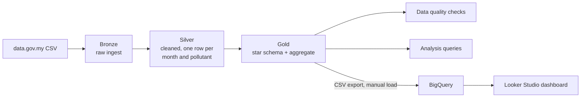
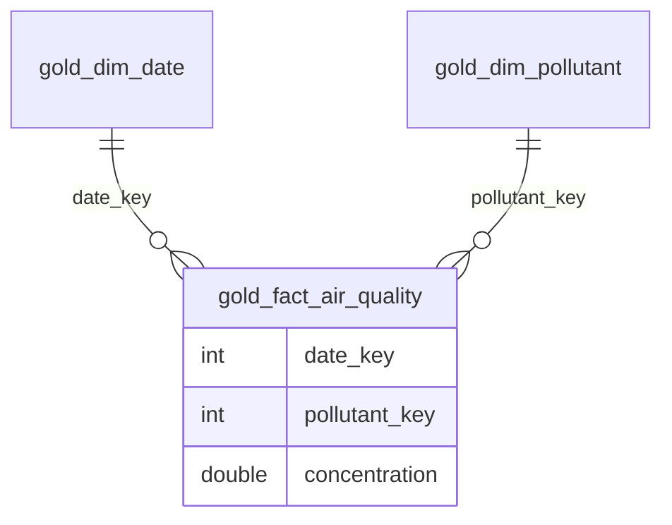
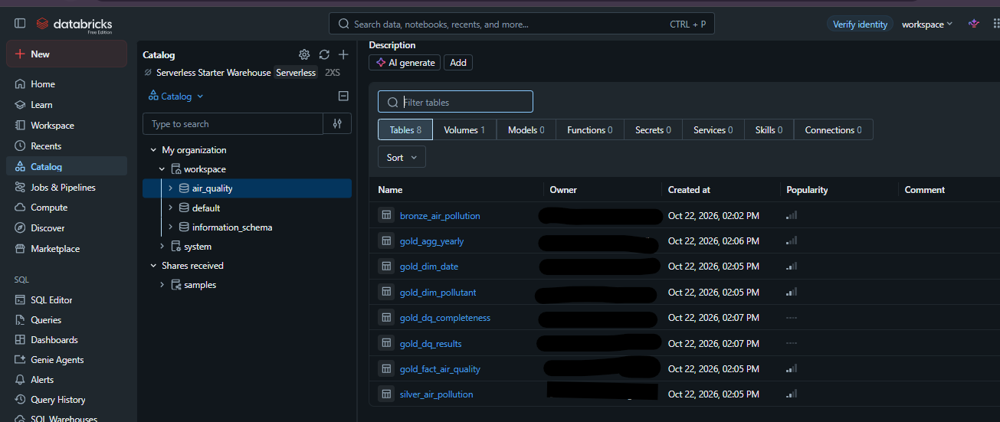
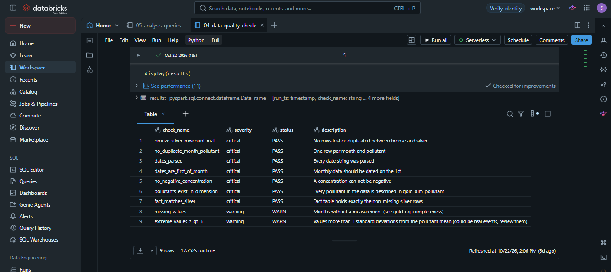
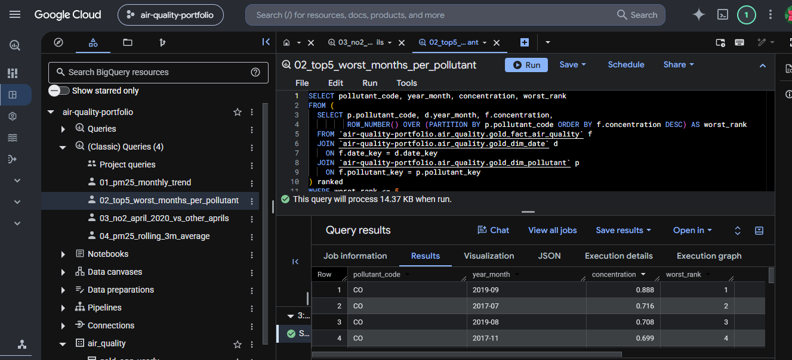
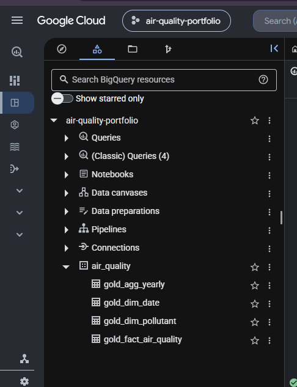

# Malaysia Air Quality Lakehouse

A Databricks medallion pipeline (bronze, silver, gold) that turns Malaysia's monthly air pollution open data into a star schema, validates it with data quality checks, and serves it through BigQuery and a Looker Studio dashboard.

## Problem

Monthly air pollution data is published as a flat CSV with missing values and partial years. Analysts need a clean, trustworthy model they can query for trends, worst months and year-over-year changes, and they need to know where the data is incomplete.

## Data source

| | |
|---|---|
| Dataset | Monthly Air Pollution |
| Publisher | Department of Environment Malaysia and Department of Statistics Malaysia, via [data.gov.my](https://data.gov.my/data-catalogue/air_pollution) |
| Download | https://storage.data.gov.my/environment/air_pollution.csv |
| Content | Monthly average concentrations, tabulated from hourly station readings across Malaysia |
| Pollutants | CO, NO2, O3, SO2 (ppm); PM10, PM2.5 (µg/m³) |
| Coverage | Monthly, 2017 to 2024 (data as of 31 Dec 2024) |
| Licence | Creative Commons Attribution 4.0 (CC BY 4.0) |

Known gaps in the source: a small number of 2017 values are null, and all CO values for 2024 are null.

## Architecture

Processing runs on Databricks Free Edition (serverless) using SQL and Python. Tables live in `workspace.air_quality`.

## Notebooks

| Notebook | Purpose |
|---|---|
| `01_bronze_ingest` | Read the raw CSV from a Unity Catalog volume and land it in a Delta table with every column as a string, plus audit columns (`_ingested_at`, `_source_file`). Only change: `date` is renamed `reading_date` |
| `02_silver_clean` | Parse dates, standardise pollutant codes (`PM 10` becomes `PM10`), turn empty values into `NULL` flagged by `is_missing` (no values are invented), and keep one row per month and pollutant (latest ingested) |
| `03_gold_star_schema` | Build dimension, fact and aggregate tables |
| `04_data_quality_checks` | Run 9 validation checks and store the results |
| `05_analysis_queries` | Trend, ranking and rolling-average queries |

Run order is 01 to 05 (notebook 04 reads the gold tables).

Record counts: bronze **576** rows (96 months x 6 pollutants), silver **576** rows (the row-count check confirms no rows were lost), gold fact **[ADD]** rows (silver rows with a measurement).

## Gold layer: star schema

| Table | Type | Grain |
|---|---|---|
| `gold_dim_date` | dimension | one row per month |
| `gold_dim_pollutant` | dimension | one row per pollutant |
| `gold_fact_air_quality` | fact | one row per month and pollutant that has a measurement |
| `gold_agg_yearly` | aggregate | one row per year and pollutant |
| `gold_dq_results` | data quality | one row per check |
| `gold_dq_completeness` | data quality | missing-month report |

Design decisions:
- **Full monthly calendar** in `gold_dim_date`, so months without data are still visible and can be reported.
- **Missing months are not loaded into the fact table.** They are reported in the data quality notebook instead.
- **`months_with_data`** in the yearly aggregate shows how complete each year is.
- Notebooks use `CREATE OR REPLACE TABLE`, so they can be re-run safely.

## Data quality

`04_data_quality_checks` runs 9 checks. Each check counts the rows that violate a rule, and zero violations means PASS.

- **Critical** checks fail the job (the notebook raises an exception) when violations are found.
- **Warning** checks are recorded but do not stop the pipeline.
- Results are appended to `gold_dq_results`, so every run is kept as history.

All 7 critical checks pass; 2 warnings are raised on purpose for review.

| Check | Severity | Status | What it verifies |
|---|---|---|---|
| `bronze_silver_rowcount_match` | critical | PASS | No rows lost or duplicated between bronze and silver |
| `no_duplicate_month_pollutant` | critical | PASS | One row per month and pollutant |
| `dates_parsed` | critical | PASS | Every date string was parsed |
| `dates_are_first_of_month` | critical | PASS | Monthly data is dated on the 1st |
| `no_negative_concentration` | critical | PASS | A concentration cannot be negative |
| `pollutants_exist_in_dimension` | critical | PASS | Every pollutant is described in `gold_dim_pollutant` |
| `fact_matches_silver` | critical | PASS | Fact table holds exactly the non-missing silver rows |
| `missing_values` | warning | WARN | Months without a measurement (see `gold_dq_completeness`) |
| `extreme_values_z_gt_3` | warning | WARN | Values more than 3 standard deviations from the pollutant mean (could be real events) |

The two warnings reflect properties of the source data (null values, genuine extreme readings), not pipeline errors.

## Analysis

Queries are in [`bigquery/`](bigquery/) (BigQuery SQL) and in notebook `05_analysis_queries` (Databricks SQL):

1. `01_pm25_monthly_trend.sql`: PM2.5 monthly trend
2. `02_top5_worst_months_per_pollutant.sql`: five worst months per pollutant
3. `03_no2_april_2020_vs_other_aprils.sql`: NO2 in April 2020 compared with other Aprils
4. `04_pm25_rolling_3m_average.sql`: three-month rolling average of PM2.5

Example findings:
- CO peaked in **September 2019** at 0.888 ppm.
- PM2.5 yearly average rose from 16.25 µg/m³ in 2018 to 20.49 in 2019, then fell to 12.29 in 2020, about **-40%** year over year.
- April 2020 NO2 compared with other Aprils: **[ADD result from query 3]**.

## Serving layer: BigQuery and Looker Studio

The gold tables were exported to CSV from Databricks and loaded into a BigQuery dataset (`air_quality`) using the BigQuery sandbox. A Looker Studio dashboard reads `gold_agg_yearly` and shows the yearly trend per pollutant, year-over-year change and data completeness.

## How to run

1. Download the CSV from data.gov.my (link above).
2. In Databricks, upload it to the volume `workspace.air_quality.raw` (Catalog, then Upload to this volume) as `air_pollution.csv`.
3. Run notebooks `01` to `05` in order. Every notebook can be re-run safely.

## Limitations

- Built on free tiers. The Databricks to BigQuery load is a **manual CSV export and upload**, not an automated pipeline.
- No scheduling or orchestration yet.
- Year-over-year change is misleading for partial years (2017 and 2024); check `months_with_data`.
- Source data is national monthly averages, so station-level or daily analysis is not possible.

## Next steps

- Schedule the notebooks with Databricks Workflows.
- Add anomaly detection on the PM2.5 and NO2 time series.
- Rewrite transformations in PySpark and model the gold layer in dbt.
- Define the infrastructure (BigQuery dataset, storage) as code with Terraform.

## Tech stack

Databricks (serverless, Unity Catalog), SQL, Python, BigQuery, Looker Studio, GitHub.

## Data attribution

Contains data from Department of Environment Malaysia and Department of Statistics Malaysia, published on data.gov.my under CC BY 4.0.
