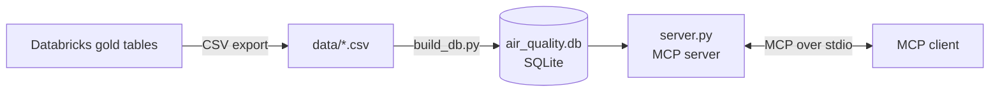

# Air Quality MCP Server

A small [Model Context Protocol](https://modelcontextprotocol.io) (MCP) server, written in Python, that lets an AI client query the gold tables of the [air quality lakehouse](../README.md) through four read-only tools.

## Tools

| Tool | What it returns |
|---|---|
| `get_yearly_average(pollutant)` | Yearly average, months with data and year-over-year change. Years with fewer than 12 months are marked `is_partial_year` |
| `top_worst_months(pollutant, n)` | The `n` months (1 to 12) with the highest concentration |
| `get_anomalies(pollutant)` | Months flagged by a robust z-score and/or Isolation Forest, with `flag_both` where the two agree |
| `data_quality_summary()` | Results of the latest data quality run (9 checks) |

Supported pollutants: `CO`, `NO2`, `O3`, `SO2`, `PM10`, `PM2.5`.

## Architecture



## Design choices

- **Read-only.** The database is opened in read-only mode, so no tool can change the data.
- **No free-form SQL.** Each tool runs a fixed, parameterised query. The client supplies a pollutant and a number, never SQL.
- **Validated input.** Unknown pollutants are rejected with a clear message, and `n` is limited to 1 to 12.
- **Honest data.** Yearly results carry `is_partial_year`, so a partial year is not mistaken for a full one, and anomaly results carry a note that a flag is a prompt to investigate, not proof of an event.

## Run it

1. Create a virtual environment and install the packages:
   ```
   python -m venv .venv
   .venv\Scripts\activate
   pip install "mcp[cli]" pandas
   ```
2. Export the gold tables from Databricks as CSV into `data/`: `gold_dim_date`, `gold_dim_pollutant`, `gold_fact_air_quality`, `gold_agg_yearly`, `gold_anomalies`, `gold_dq_results`.
3. Build the local database:
   ```
   python build_db.py
   ```
4. Check the tools with the test client:
   ```
   python test_client.py
   ```
5. Explore them in the MCP Inspector:
   ```
   npx @modelcontextprotocol/inspector python server.py
   ```

The code uses version 2 of the MCP Python SDK (`MCPServer`). With version 1, import `FastMCP` from `mcp.server.fastmcp` instead.

## Screenshots

| | |
|---|---|
| `top_worst_months` | `get_yearly_average` |
| --- | --- |
|  |  |
| **`get_anomalies`** | **`data_quality_summary`** |
|  |  |

## Limitations

- The data is a **copy** of the Databricks gold tables (a CSV export), not a live connection, so it must be exported again when the pipeline is re-run.
- Tested with the MCP Inspector and a small test client. It has not been connected to an AI assistant yet.
- Learning project built on public data (see the main README for the source and licence).

## Planned

- A `forecast` tool backed by a time-series model for PM2.5 and NO2, served as a containerised service.
