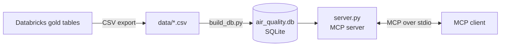
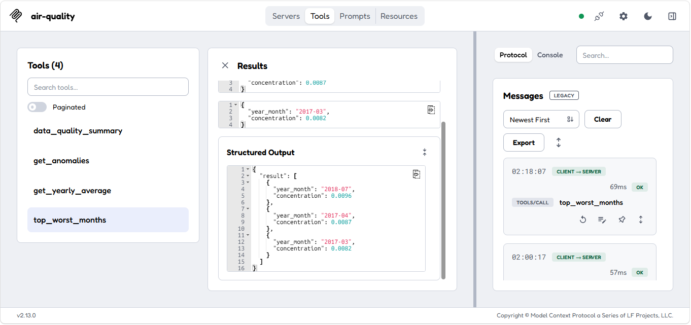
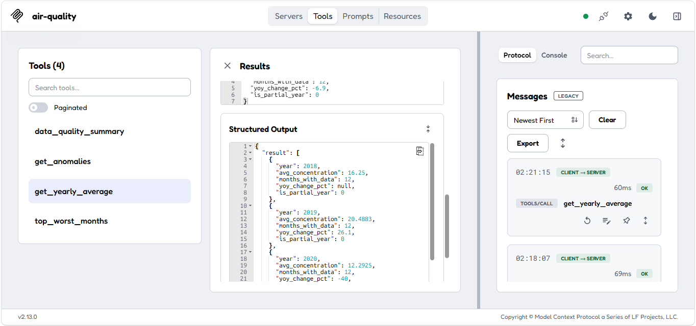
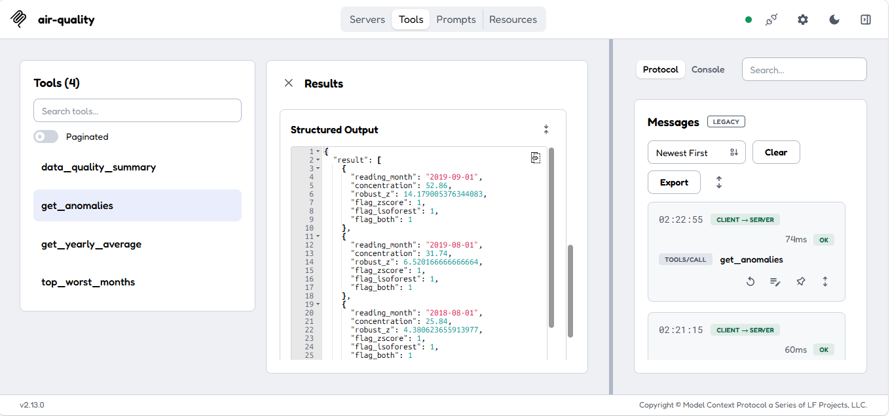
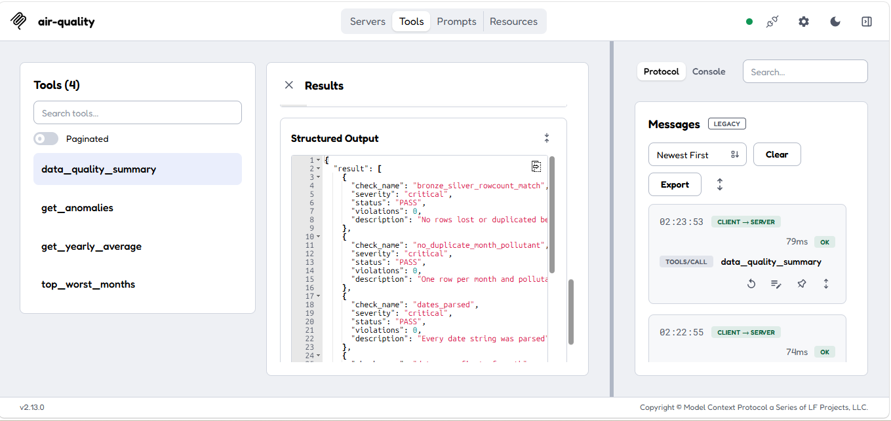
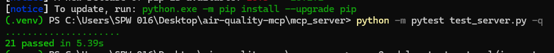
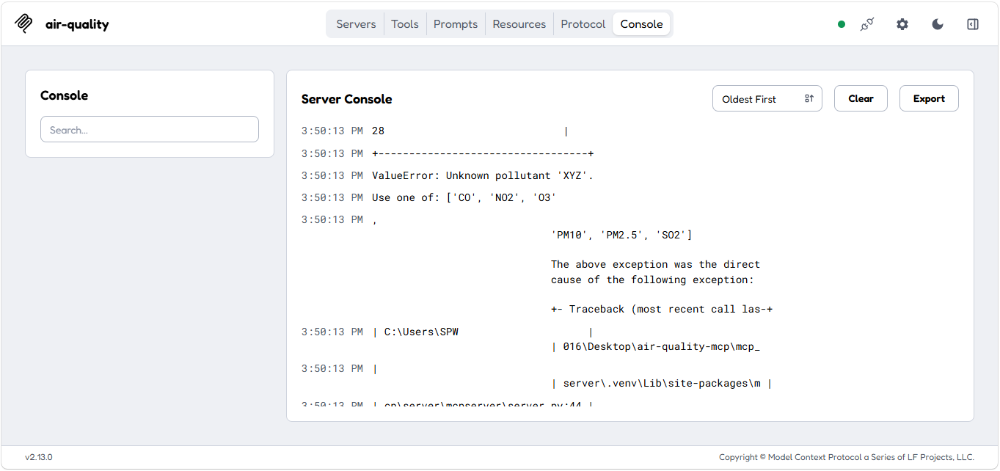
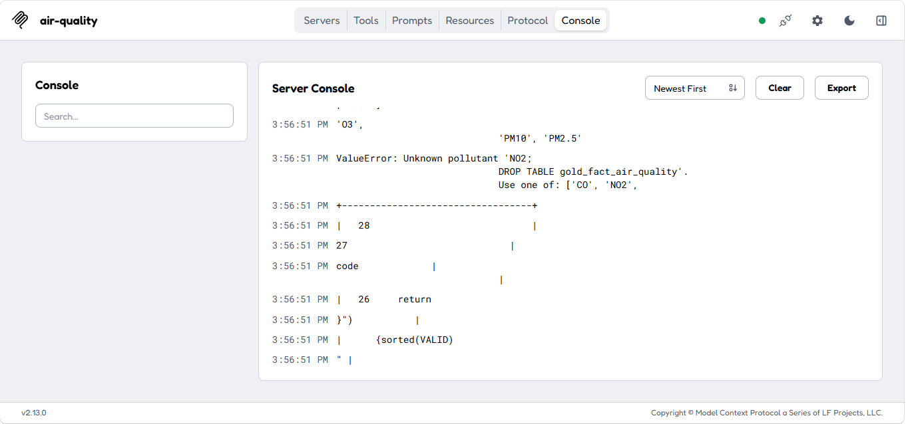
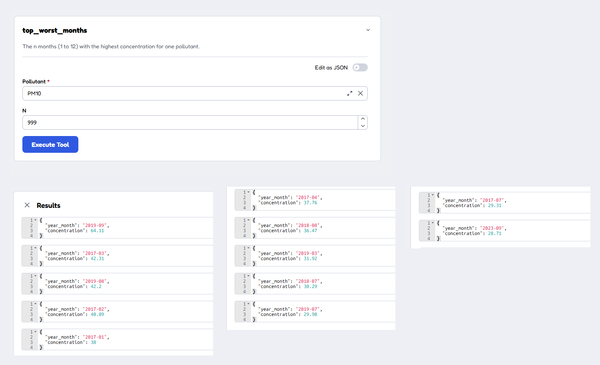

# Air Quality MCP Server

A small [Model Context Protocol](https://modelcontextprotocol.io) (MCP) server, written in Python, that lets an AI client query the gold tables of the [air quality lakehouse](../README.md) through four read-only tools.

## Tools

| Tool | What it returns |
|---|---|
| `get_yearly_average(pollutant)` | Yearly average, months with data and year-over-year change. Years with fewer than 12 months are marked `is_partial_year` |
| `top_worst_months(pollutant, n)` | The `n` months (1 to 12) with the highest concentration |
| `get_anomalies(pollutant)` | Months flagged by a robust z-score and/or Isolation Forest, with `flag_both` where the two agree |
| `data_quality_summary()` | Results of the latest data quality run (9 checks) |

Supported pollutants: `CO`, `NO2`, `O3`, `SO2`, `PM10`, `PM2.5`.

## Architecture



## Design choices

- **Read-only.** The database is opened in read-only mode, so no tool can change the data.
- **No free-form SQL.** Each tool runs a fixed, parameterised query. The client supplies a pollutant and a number, never SQL.
- **Validated input.** Unknown pollutants are rejected with a clear message, and `n` is limited to 1 to 12.
- **Honest data.** Yearly results carry `is_partial_year`, so a partial year is not mistaken for a full one, and anomaly results carry a note that a flag is a prompt to investigate, not proof of an event.

## Run it

1. Create a virtual environment and install the packages:
   ```
   python -m venv .venv
   .venv\Scripts\activate
   pip install "mcp[cli]" pandas
   ```
2. Export the gold tables from Databricks as CSV into `data/`: `gold_dim_date`, `gold_dim_pollutant`, `gold_fact_air_quality`, `gold_agg_yearly`, `gold_anomalies`, `gold_dq_results`.
3. Build the local database:
   ```
   python build_db.py
   ```
4. Check the tools with the test client:
   ```
   python test_client.py
   ```
5. Explore them in the MCP Inspector:
   ```
   npx @modelcontextprotocol/inspector python server.py
   ```

The code uses version 2 of the MCP Python SDK (`MCPServer`). With version 1, import `FastMCP` from `mcp.server.fastmcp` instead.

## Screenshots

| | |
|---|---|
| `top_worst_months` | `get_yearly_average` |
| --- | --- |
|  |  |
| **`get_anomalies`** | **`data_quality_summary`** |
|  |  |

## Testing

The server is tested in two ways: an automated pytest suite, and manual checks in MCP Inspector.

### Automated tests (pytest)

`test_server.py` has 21 tests. They build a small temporary SQLite database, so they run anywhere without the real data.

What they cover:

- **Normal use**: lowercase pollutant names are normalised, years with fewer than 12 months are marked as partial, only flagged months are returned as anomalies, and only the latest data quality run is returned.
- **Malformed input**: unknown or empty pollutant names, SQL-injection-style strings, and `n` values that are too large, negative or not a number. `n` is clamped to the range 1 to 12.
- **Read-only enforcement**: `INSERT`, `UPDATE`, `DELETE` and `DROP` all fail because the database is opened with `mode=ro`, and the data is unchanged after every tool has been called.

To run them (inside the virtual environment):

```
pip install pytest
python -m pytest test_server.py -q
```



### Manual checks in MCP Inspector

| Input | Result |
|---|---|
| `get_yearly_average` with `XYZ` | Rejected by the allow-list (`ValueError: Unknown pollutant 'XYZ'`) |
| `get_yearly_average` with `NO2; DROP TABLE gold_fact_air_quality` | Rejected before any SQL runs |
| `top_worst_months` with `PM10` and `n = 999` | 12 rows returned (clamped) |







### Notes on the design

- None of the tools accept SQL from the caller. Each tool takes only a pollutant code or a small number, and the queries are fixed with bound parameters.
- The read-only connection is a second layer of protection, not the only one.
- MCP Inspector shows rejected calls as a generic "Error executing tool" message. The full `ValueError` message is in the Server Console and is checked directly by the pytest suite.

## Limitations

- The data is a **copy** of the Databricks gold tables (a CSV export), not a live connection, so it must be exported again when the pipeline is re-run.
- Tested with an automated pytest suite, the MCP Inspector and a small test client. It has not been connected to an AI assistant yet.
- Learning project built on public data (see the main README for the source and licence).

## Planned

- A `forecast` tool backed by a time-series model for PM2.5 and NO2, served as a containerised service.
