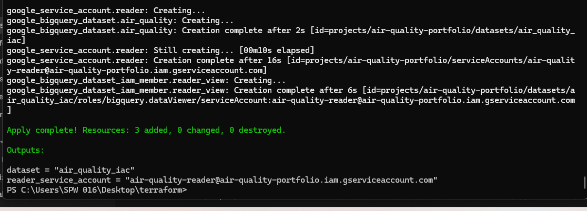

# Terraform: BigQuery serving layer

Infrastructure as code for the BigQuery part of the [Air Quality Lakehouse](../README.md) project. Terraform creates the dataset, a table definition and a read-only service account, so the setup can be recreated or removed with one command instead of clicking through the console.

## What it creates

| Resource | Purpose |
|---|---|
| `google_bigquery_dataset.air_quality` | Dataset `air_quality_iac` (US), labelled as managed by Terraform |
| `google_bigquery_table.gold_agg_yearly` | Table schema for the yearly aggregate (7 columns, same as the gold table) |
| `google_service_account.reader` | Service account `air-quality-reader` |
| `google_bigquery_dataset_iam_member.reader_view` | Gives that account `roles/bigquery.dataViewer` on the dataset only (least privilege) |

## Files

| File | Content |
|---|---|
| `main.tf` | Provider, dataset, service account and IAM binding |
| `tables.tf` | `gold_agg_yearly` table and schema |
| `variables.tf` | Project ID, region, dataset location and dataset ID (with defaults) |
| `outputs.tf` | Dataset ID and service account email |

## How to run

Requires Terraform 1.5 or newer and the Google Cloud CLI.

```bash
gcloud auth application-default login
gcloud config set project <your-project-id>
terraform init
terraform plan
terraform apply
```

To remove everything: `terraform destroy`.



## Design notes

- A separate dataset (`air_quality_iac`) is used so the Terraform-managed copy does not clash with the original dataset created by hand.
- Table schema mirrors the existing `gold_agg_yearly` exactly, including `yoy_change_pct` as `STRING`. A cleaner design would make it `FLOAT64`.
- The service account only has read access to one dataset.
- `deletion_protection = false` and a 60-day table expiry fit a sandbox and learning setup.

## Limitations

- Built on the BigQuery **sandbox** (no billing), so services that need billing, such as Cloud Storage buckets, are not included.
- State is stored **locally** (`terraform.tfstate`, not committed). A team setup would use a remote backend.
- Only one table is defined, and the table is created empty. Data is still loaded manually from CSV exports, as described in the main README.
- Not yet run through CI. A next step is `terraform fmt` and `terraform validate` on every push with GitHub Actions.
